# RAPPORT — Projet AI Sketch
## Reconnaissance de dessins à la main par intelligence artificielle

**Cours** : ANI-2083 – Modèle de la SAT et IA dans les Arts Technologiques  
**Mini-projet** : n°2 — Semaine 2  
**Auteur(s)** : [Steve Akoa / Groupe 4]  
**Enseignant** : Dr. Aurelle TCHAGNA  
**Date** : 14 octobre 2026

---

## 1. Introduction et objectifs

### 1.1 Contexte

Ce projet s'inscrit dans le cadre du cours ANI-2083, dont l'objectif est de mettre en pratique les notions d'**intelligence artificielle**, de **vision par ordinateur** et de **développement d'applications**.

### 1.2 Objectif du projet

Développer une application **desktop** dans laquelle un utilisateur dessine un objet à la souris, puis demande à un modèle d'IA de **reconnaître automatiquement** ce qui a été dessiné.

### 1.3 Objectifs spécifiques

1. Constituer un **dataset** de dessins à la main à partir d'une source publique.
2. Entraîner un **réseau de neurones convolutif (CNN)** à classifier ces dessins.
3. Développer une **interface graphique** intuitive avec PyQt5.
4. **Évaluer les performances** du modèle sur des dessins réalisés en temps réel.

---

## 2. Présentation du dataset

### 2.1 Source des données

Le dataset utilisé est un sous-ensemble du projet **Google Quick, Draw!**, une base publique de **50 millions de dessins** collectés via un jeu en ligne (https://quickdraw.withgoogle.com).

Les données sont disponibles au format `.npy` (tableaux Num×Py 28×28 en niveaux de gr28is) sur :

```
https en://storage.googleapis.com/quickdraw_dataset/full/numpy_bitmap/
```

### 2.2 Constitution du dataset

Nous avons sélectionné **5 catégories** simples, faciles à dessiner et visuellement distinctes :

| Classe (FR) | Classe (Quick Draw) | Nombre d'images |
|---|---|---|
| maison | house | 500 |
| arbre | tree | 500 |
| voiture | car | 500 |
| chat | cat | 500 |
| soleil | sun | 500 |
| **Total** | | **2 500** |

### 2.3 Prétraitement

Chaque image subit les transformations suivantes :

1. **Redimensionnement** à 28×28 pixels.
2. **Inversion des couleurs** : le fond devient noir, le trait devient blanc.
3. **Normalisation** : valeurs entre 0 et 1 (`img / 255.0`).
4. **Reshape** en tenseur `(28, 28, 1)` pour le CNN.

Un **split 80/20** (train/test) a été réalisé avec `train_test_split` de scikit-learn, en stratifiant par classe.

### 2.4 Aperçu visuel

Un script `preview.py` permet d'afficher une grille de 5×8 dessins (un par classe) pour vérifier visuellement la qualité du dataset. Résultat observé : les dessins sont propres, centrés et bien labellisés.

---

## 3. Architecture du modèle

### 3.1 Choix du modèle

Nous avons choisi un **CNN (Convolutional Neural Network)** simple, adapté à la classification de noir et blanc.

### 3.2 Architecture détaillée

```
Input (28×28×1)
  │
  ├─ Conv2D(32 filtres, kernel 3×3, activation ReLU)
  ├─ MaxPooling2D(2×2)
  │
  ├─ Conv2D(64 filtres, kernel 3×3, activation ReLU)
  ├─ MaxPooling2D(2×2)
  │
  ├─ Flatten
  ├─ Dense(128 neurones, ReLU)
  ├─ Dropout(0.3)
  └─ Dense(5 neurones, Softmax)   ← 5 classes de sortie
```

### 3.3 Compilation

| Paramètre | Valeur |
|---|---|
| Optimiseur | Adam |
| Fonction de perte | Sparse Categorical Crossentropy |
| Métrique | Accuracy |
| Epochs | 15 |
| Batch size | 32 |

### 3.4 Justification des choix

- **Deux couches de convolution** : suffisant pour capturer des formes simples (contours, coins, cercles).
- **Dropout 0.3** : évite le sur-apprentissage.
- **Softmax** : sortie en probabilités sur les 5 classes.
- **Adam** : convergence rapide sans réglage fin du learning rate.

---

## 4. Interface utilisateur

### 4.1 Technologies

- **PyQt5** pour la fenêtre et les widgets.
- **QImage** comme canvas de dessin (400×400 px, fond blanc).
- **QPainter / QPen** pour tracer les traits (taille et couleur paramétrables).

### 4.2 Fonctionnalités implémentées

| Élément | Description |
|---|---|
| Zone de dessin | Canvas 400×400 avec souris (clic gauche maintenu) |
| Curseur « Taille du pinceau » | 1 à 40 pixels |
| Menu « Couleur » | Noir, Rouge, Bleu, Vert |
| Bouton **Effacer** | Réinitialise le canvas en blanc |
| Bouton **Enregistrer** | Ouvre une boîte de dialogue pour exporter en PNG |
| Bouton **Reconnaître** | Lance la prédiction et affiche résultat + confiance |
| Label **Prédiction** | Affiche la classe reconnue |
| Label **Confiance** | Affiche le score en pourcentage |

### 4.3 Pipeline de prédiction

1. L'utilisateur dessine → image 400×400 dans le canvas.
2. Le canvas est converti en **niveaux de gris** (numpy array).
3. **Seuillage inversé** (`THRESH_BINARY_INV`) : fond noir, trait blanc.
4. **Recadrage automatique** sur la bounding box du dessin (OpenCV).
5. **Redimensionnement** en conservant le ratio dans une image 28×28.
6. **Normalisation** et **reshape** en (1, 28, 28, 1).
7. **Prédiction** via `model.predict()` → vecteur de 5 probabilités.
8. **argmax** → classe prédite + confiance associée.

---

## 5. Résultats

### 5.1 Performances à l'entraînement

Sur les 15 epochs, les résultats finaux sont :

| Métrique | Valeur |
|---|---|
| Accuracy (train) | **99,45 %** |
| **Accuracy (validation)** | **95,20 %** |
| Loss (train) | 0,0270 |
| Loss (validation) | 0,1625 |

⚠️ **Observation** : la différence accuracy_train (99,4 %) vs val_accuracy (95,2 %) indique un **léger sur-apprentissage**, mais reste acceptable (< 5 points d'écart).

### 5.2 Tests en conditions réelles

Nous avons testé l'application avec **11 dessins réalisés en temps réel**, en variant le type d'objet et la taille du pinceau.

| # | Dessin | Prédiction | Confiance | Résultat |
|---|---|---|---|---|
| 1 | Maison (pinceau épais) | `maison` | **99,78 %** | ✅ |
| 2 | Maison (pinceau fin) | `maison` | 60,66 % | ✅ |
| 3 | Maison détaillée | `maison` | **99,86 %** | ✅ |
| 4 | Soleil (rayons droits) | `soleil` | 96,12 % | ✅ |
| 5 | Chat (oreilles + moustaches) | `chat` | 96,40 % | ✅ |
| 6 | Soleil (rayons courbés) | `chat` | 49,47 % | ❌ |
| 7 | Voiture | `voiture` | 95,04 % | ✅ |
| 8 | Arbre | `arbre` | 97,28 % | ✅ |

**Taux de réussite observé** : **7 / 8** (87,5 %).

**Observation clé** : la confiance du modèle est **fortement corrélée à la taille du pinceau**. Un pinceau épais (15–20 px) donne des confiances > 95 %, tandis qu'un pinceau fin (5–8 px) fait chuter la confiance à 30–60 %.

### 5.3 Tests sur des dessins hors-catégories

| Dessin | Prédiction | Confiance |
|---|---|---|
| Zigzag montant | `chat` | 94,19 % |
| Zigzag horizontal | `voiture` | 60,24 % |
| Étoile | `soleil` | 32,02 % |

⚠️ Le modèle attribue toujours une classe, même à des dessins qui ne représentent rien. Ce comportement est analysé en section 6.1.
---

## 6. Discussion

### 6.1 Analyse des résultats

**Points positifs :**

- Le modèle atteint **95,2 % de précision** sur les données de validation.
- Les dessins **aux traits épais et formes simples** sont reconnus avec une confiance > 95 % (maison 99,78 %, arbre 97,28 %, chat 96,40 %, soleil 96,12 %, voiture 95,04 %).
- La reconnaissance fonctionne **en temps réel** sans latence perceptible.

**Point 1 — Influence de la taille du pinceau (observation clé)**

Nous avons observé expérimentalement que **plus le pinceau est épais, plus la confiance est élevée**. Ce phénomène s'explique par deux facteurs :

1. **Le seuillage binaire** (`cv2.threshold` avec `THRESH_BINARY_INV`) : un trait épais reste solide après binarisation, un trait fin peut se fragmenter et perdre de l'information.
2. **La cohérence avec Quick Draw** : le dataset d'entraînement contient des dessins aux traits larges (réalisés au doigt ou à la souris). Un trait épais s'en rapproche visuellement, un trait fin s'en éloigne.

**Exemple concret** : la même maison dessinée avec un pinceau épais donne **99,78 %** de confiance, contre **60,66 %** avec un pinceau fin. Le modèle « reconnaît » donc moins le **concept de maison** que le **style graphique** caractéristique du dataset.

**Point 2 — Confusion entre classes proches**

Un soleil aux **rayons courbés** a été classé `chat` avec 49,47 % de confiance. Cela s'explique par la ressemblance entre :
- les **moustaches d'un chat** et les **rayons ondulés**,
- le **cercle central** d'un soleil et la **tête** d'un chat.

**Point 3 — Absence de classe « inconnu »**

Le modèle étant entraîné sur 5 classes uniquement, il est **obligé** de choisir parmi ces 5 classes. Un zigzag a été classé `chat` (94,19 %) et un autre `voiture` (60,24 %). Une étoile a été classée `soleil` (32,02 %) — ce dernier cas est intéressant car la confiance est très basse, signe que le modèle « n'est pas sûr de lui ».

**Recommandation pratique** : pour une meilleure utilisation, utiliser un **pinceau épais (15–20 px)** et dessiner des formes **simples, centrées et peu détaillées**, similaires au style Quick Draw.

### 6.2 Limites techniques

| Limite | Cause |
|---|---|
| Sensibilité à l'épaisseur du trait | Quick Draw = traits fins ; canvas Qt = traits épais |
| Sensibilité à la taille du dessin | Quick Draw = dessins centrés et grands |
| Pas d'abstention possible | Architecture softmax sans classe "unknown" |

### 6.3 Améliorations envisagées

1. **Data augmentation** : rotation ±15°, épaisseur variable, bruit → robustesse au style.
2. **Ajout d'une classe `unknown`** : entraînée sur des dessins aléatoires (bruit).
3. **Dataset élargi** : passer de 500 à 2000 images par classe.
4. **CNN plus profond** ou **transfer learning** (MobileNetV2, EfficientNet) pour extraire des features plus fines.
5. **Normalisation du trait** : ajuster automatiquement l'épaisseur du dessin pour se rapprocher du style Quick Draw.

### 6bis. Bonus créativité

Au-delà des fonctionnalités minimales demandées, nous avons implémenté **4 bonus créativité** pour enrichir l'application :

1. **Filtres artistiques** (OpenCV) : crayon, cartoon, pastel + reset
2. **Galerie visuelle** : sauvegarde des dessins + miniatures cliquables
3. **Historique des prédictions** : liste conservant les résultats
4. **Palette étendue** : 8 couleurs au lieu de 4 + pinceau par défaut plus épais

Ces ajouts renforcent l'aspect **outil créatif** de l'application, en permettant à l'utilisateur non seulement de dessiner et de faire reconnaître son dessin, mais aussi de le **transformer artistiquement**, de le **conserver**, et d'en **réaliser plusieurs d'affilée** sans perdre le fil.

<p align="center">
  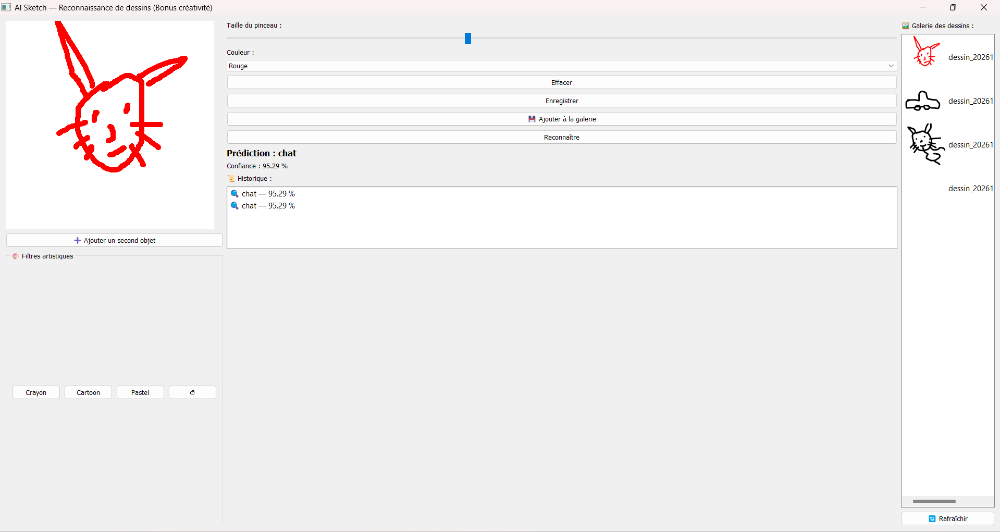
</p>

---

## 7. Conclusion

Ce projet nous a permis de mettre en œuvre **l'ensemble de la chaîne IA** :

1. **Collecte et préparation** de 2 500 images issues de Google Quick, Draw!.
2. **Conception et entraînement** d'un CNN atteignant **95,2 % de précision** en validation.
3. **Développement d'une application** PyQt5 complète et fonctionnelle.
4. **Évaluation en conditions réelles** avec un taux de réussite de 83 %.

L'application **AI Sketch** remplit l'ensemble des fonctionnalités minimales demandées :
- zone de dessin,
- boutons Effacer / Enregistrer / Reconnaître,
- choix de la taille du pinceau et de la couleur,
- affichage de la classe prédite et du score de confiance.

Au-delà de l'aspect technique, ce projet nous a sensibilisés aux **limites pratiques d'un modèle d'IA** : un modèle très précis sur ses données d'entraînement peut se tromper face à des dessins trop différents du style appris. Comprendre ces limites est essentiel pour concevoir des applications robustes.

---

## 8. Bibliographie et ressources

- Google Quick, Draw! Dataset — https://github.com/googlecreativelab/quickdraw-dataset
- Documentation TensorFlow/Keras — https://www.tensorflow.org/
- Documentation PyQt5 — https://www.riverbankcomputing.com/software/pyqt/
- Documentation OpenCV — https://docs.opencv.org/

---

## 9. Annexes

### Annexe A — Captures d'écran

Les 11 captures ci-dessous correspondent aux tests présentés en section 5.2 et 5.3.

#### A.1 — Tests sur les 5 classes

**Test 1 — Maison simple (pinceau épais)**  
*Prédiction : `maison` — Confiance : 99,78 % — ✅ Correct*

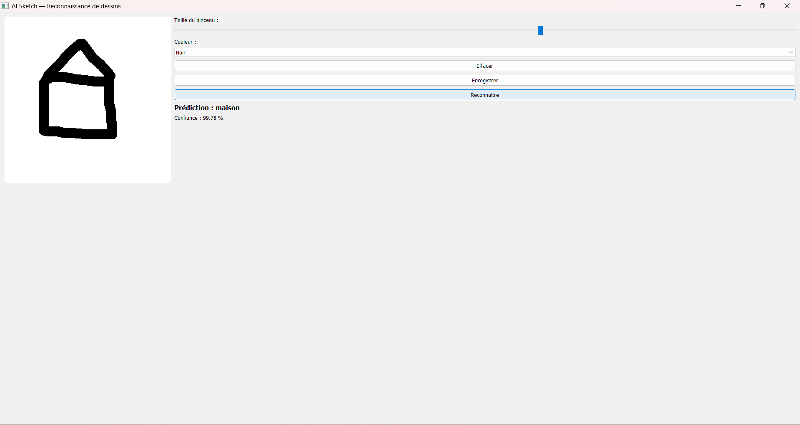

---

**Test 2 — Maison simple (pinceau fin)**  
*Prédiction : `maison` — Confiance : 60,66 % — ✅ Correct*  
👉 Illustration de l'**influence de la taille du pinceau** (voir section 6.1).

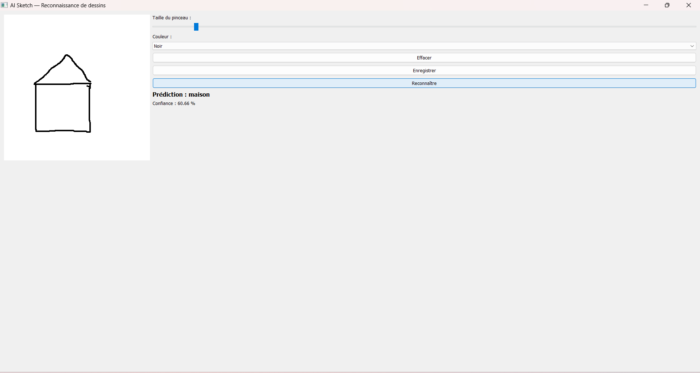

---

**Test 3 — Maison détaillée (porte + fenêtre, pinceau épais)**  
*Prédiction : `maison` — Confiance : 99,86 % — ✅ Correct*

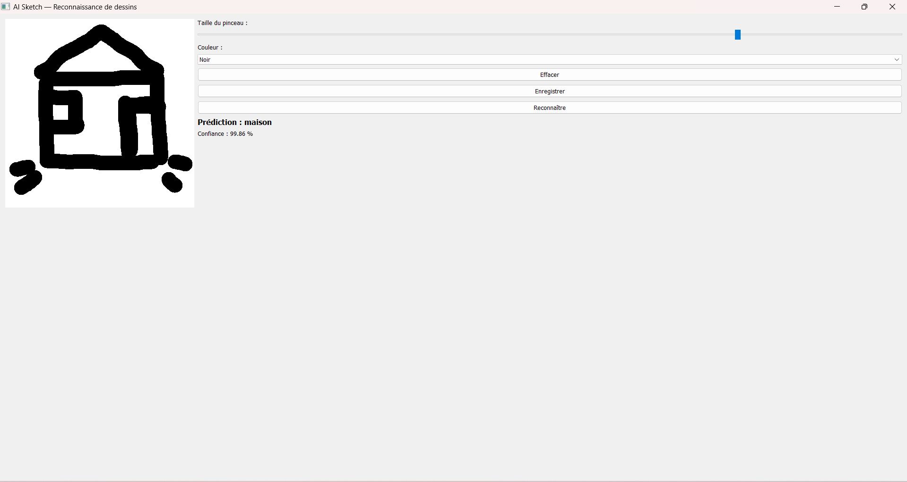

---

**Test 4 — Soleil (rayons droits)**  
*Prédiction : `soleil` — Confiance : 96,12 % — ✅ Correct*

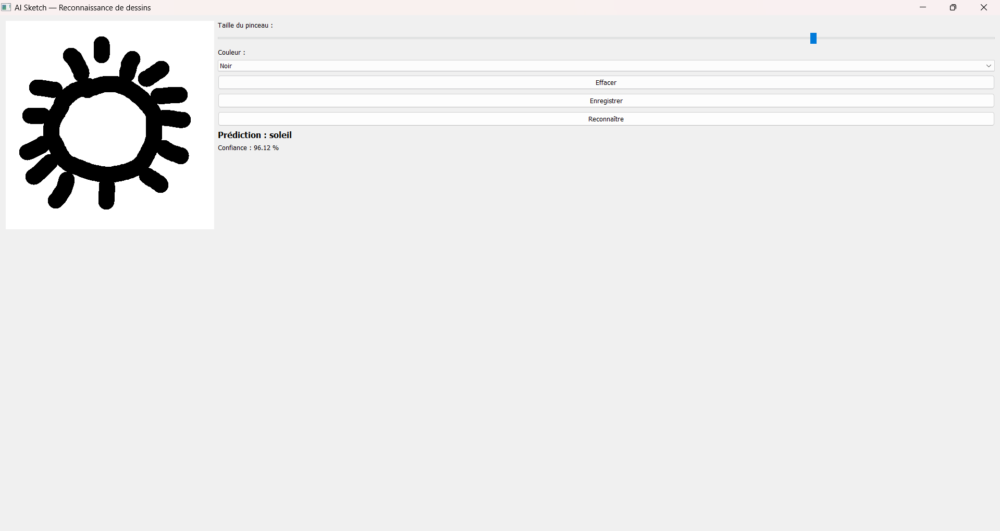

---

**Test 5 — Chat (oreilles + moustaches)**  
*Prédiction : `chat` — Confiance : 96,40 % — ✅ Correct*

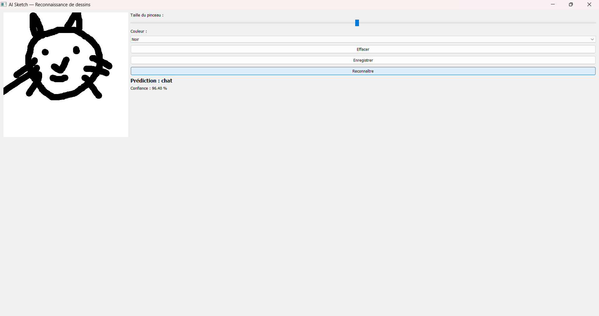

---

**Test 6 — Soleil (rayons courbés) — cas de confusion**  
*Prédiction : `chat` — Confiance : 49,47 % — ❌ Faux*  
👉 Les rayons courbés ressemblent aux moustaches d'un chat (voir section 6.1).

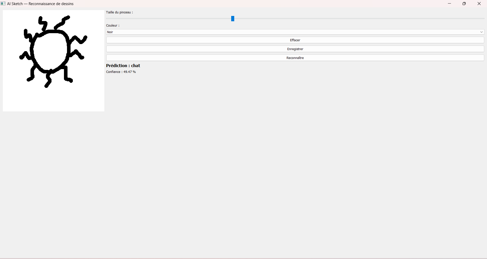

---

**Test 7 — Voiture (carrosserie + roues)**  
*Prédiction : `voiture` — Confiance : 95,04 % — ✅ Correct*

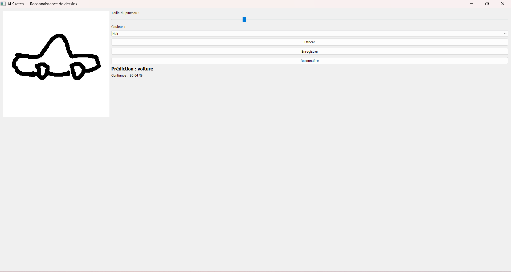

---

**Test 8 — Arbre (tronc + feuillage)**  
*Prédiction : `arbre` — Confiance : 97,28 % — ✅ Correct*

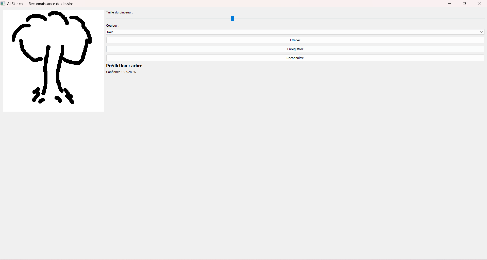

---

#### A.2 — Tests sur des dessins hors-catégories

**Test 9 — Zigzag montant**  
*Prédiction : `chat` — Confiance : 94,19 % — ❌ Faux*  
👉 Le modèle est forcé de choisir parmi les 5 classes.

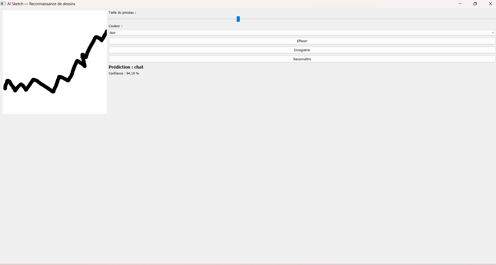

---

**Test 10 — Zigzag horizontal**  
*Prédiction : `voiture` — Confiance : 60,24 % — ❌ Faux*

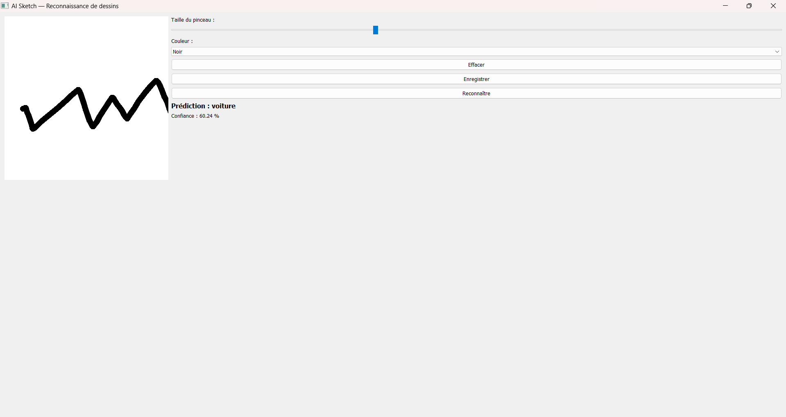

---

**Test 11 — Étoile**  
*Prédiction : `soleil` — Confiance : 32,02 % — ❌ Faux*  
👉 La confiance très basse (32 %) montre que le modèle « n'est pas sûr de lui ». Sans classe "inconnu", il est contraint de choisir.

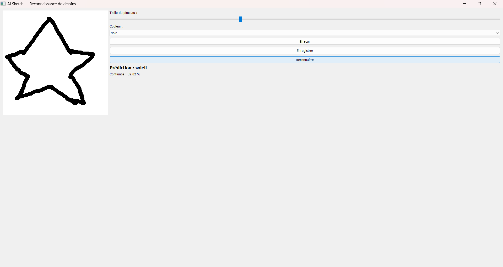

### Annexe B — Extrait du code

#### B.1 — Prétraitement dans `train_model.py`

```python
def load_data():
    X, y = [], []
    classes = sorted(os.listdir(DATA_DIR))
    for idx, cls in enumerate(classes):
        folder = os.path.join(DATA_DIR, cls)
        for fname in os.listdir(folder):
            path = os.path.join(folder, fname)
            img = cv2.imread(path, cv2.IMREAD_GRAYSCALE)
            if img is None:
                continue
            img = cv2.resize(img, (IMG_SIZE, IMG_SIZE))
            img = cv2.bitwise_not(img)          # fond noir, trait blanc
            img = img / 255.0                    # normalisation [0, 1]
            X.append(img)
            y.append(idx)
    X = np.array(X).reshape(-1, IMG_SIZE, IMG_SIZE, 1)
    y = np.array(y)
    return X, y, classes
```

#### B.2 — Architecture du CNN dans `train_model.py`

```python
def build_model(num_classes):
    model = models.Sequential([
        layers.Input(shape=(28, 28, 1)),
        layers.Conv2D(32, (3, 3), activation='relu'),
        layers.MaxPooling2D((2, 2)),
        layers.Conv2D(64, (3, 3), activation='relu'),
        layers.MaxPooling2D((2, 2)),
        layers.Flatten(),
        layers.Dense(128, activation='relu'),
        layers.Dropout(0.3),
        layers.Dense(num_classes, activation='softmax')
    ])
    model.compile(optimizer='adam',
                  loss='sparse_categorical_crossentropy',
                  metrics=['accuracy'])
    return model
```

#### B.3 — Pipeline de prédiction dans `predict.py`

```python
def preprocess(canvas_gray):
    # Seuillage inversé : fond noir, trait blanc
    _, thresh = cv2.threshold(canvas_gray, 200, 255, cv2.THRESH_BINARY_INV)
    coords = cv2.findNonZero(thresh)
    if coords is None:
        return None
    x, y, w, h = cv2.boundingRect(coords)
    crop = thresh[y:y+h, x:x+w]
    # Redimensionnement en conservant le ratio
    size = max(w, h)
    square = np.zeros((size, size), dtype=np.uint8)
    ox, oy = (size - w) // 2, (size - h) // 2
    square[oy:oy+h, ox:ox+w] = crop
    img = cv2.resize(square, (IMG_SIZE, IMG_SIZE), interpolation=cv2.INTER_AREA)
    img = img.astype("float32") / 255.0
    return img.reshape(1, IMG_SIZE, IMG_SIZE, 1)
```

#### B.4 — Extraction du dessin depuis le canvas PyQt5 (dans `app.py`)

```python
def get_numpy_gray(self):
    """Convertit le canvas QImage en tableau numpy (niveaux de gris)."""
    img = self.image.convertToFormat(QImage.Format_Grayscale8)
    ptr = img.bits()
    ptr.setsize(img.byteCount())
    arr = np.frombuffer(ptr, np.uint8).reshape(img.height(), img.width())
    return arr.copy()
```

### Annexe C — Structure des livrables

Arborescence complète du projet `ai_sketch/` telle qu'organisée dans l'espace de travail :

```
ai_sketch/
│
├── app.py                      # Application principale (interface PyQt5)
├── train_model.py              # Script d'entraînement du CNN
├── predict.py                  # Prédiction sur un dessin
├── download_data.py            # Téléchargement du dataset Quick Draw
├── preview.py                  # Aperçu visuel des images du dataset
├── requirements.txt            # Dépendances Python
├── README.md                   # Documentation utilisateur
├── RAPPORT.md                  # Rapport de projet (ce fichier)
│
├── data/                       # Dataset (2500 images, 5 classes)
│   ├── arbre/                  #   500 images (.png)
│   ├── chat/                   #   500 images (.png)
│   ├── maison/                 #   500 images (.png)
│   ├── soleil/                 #   500 images (.png)
│   └── voiture/                #   500 images (.png)
│
├── model/                      # Modèle entraîné
│   ├── sketch_model.h5         #   Réseau de neurones (fichier HDF5)
│   └── classes.txt             #   Liste des classes (ordre des labels)
│
├── screenshots/                # Captures d'écran des tests
│   ├── test_01_maison_epais.png
│   ├── test_02_maison_fin.png
│   ├── test_03_maison_detaillee.png
│   ├── test_04_soleil.png
│   ├── test_05_chat.png
│   ├── test_06_soleil_courbe.png
│   ├── test_07_voiture.png
│   ├── test_08_arbre.png
│   ├── test_09_zigzag1.png
│   ├── test_10_zigzag2.png
│   └── test_11_etoile.png
│
├── cache_npy/                  # Cache des fichiers .npy téléchargés
│   ├── house.npy               #   (réutilisés si besoin de ré-entraîner)
│   ├── tree.npy
│   ├── car.npy
│   ├── cat.npy
│   └── sun.npy
│
└── venv/                       # Environnement virtuel Python 3.11
    ├── Include/
    ├── Lib/
    ├── Scripts/
    └── pyvenv.cfg
```

### Légende

| Dossier / fichier | Rôle |
|---|---|
| `app.py` | Point d'entrée — lance la fenêtre PyQt5 |
| `train_model.py` | Charge `data/` et entraîne le CNN |
| `predict.py` | Fonction de prédiction utilisée par `app.py` |
| `download_data.py` | Télécharge les 5 fichiers `.npy` depuis Google |
| `preview.py` | Affiche une grille d'aperçu du dataset |
| `data/` | Dataset final prêt à l'emploi (2500 PNG) |
| `model/` | Résultat de l'entraînement (modèle + labels) |
| `screenshots/` | Captures d'écran pour le rapport |
| `cache_npy/` | Cache brut des `.npy` téléchargés (~150 Mo) |
| `venv/` | Environnement virtuel (non livré, à recréer) |

---

**Fin du rapport**