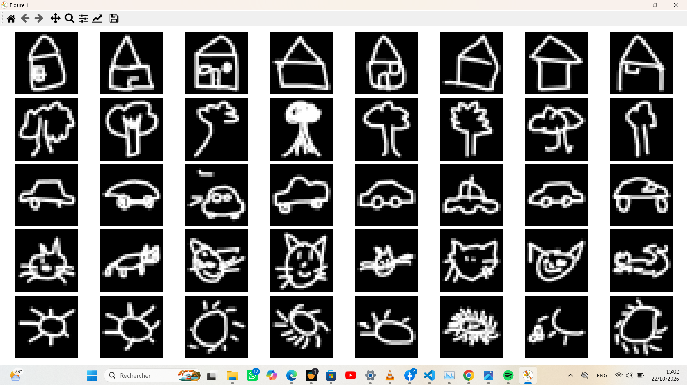
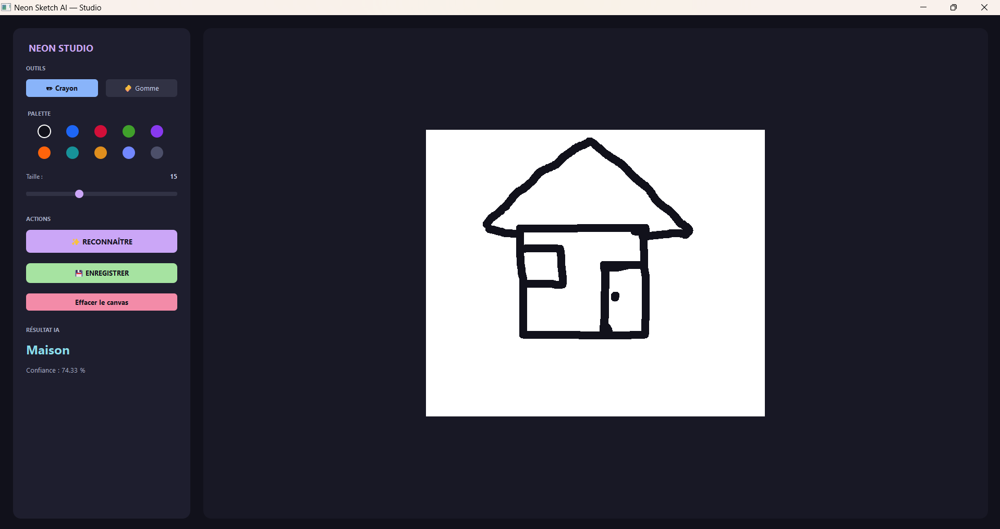
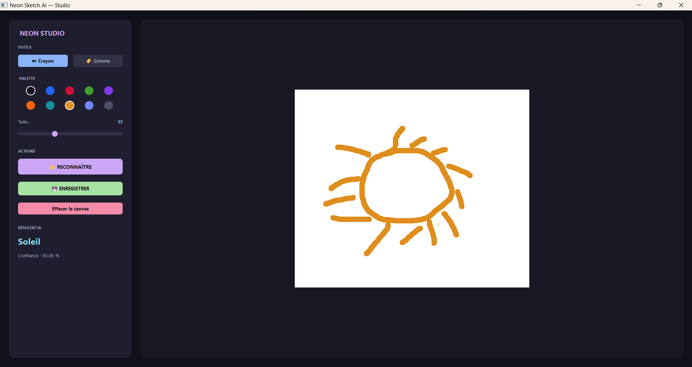
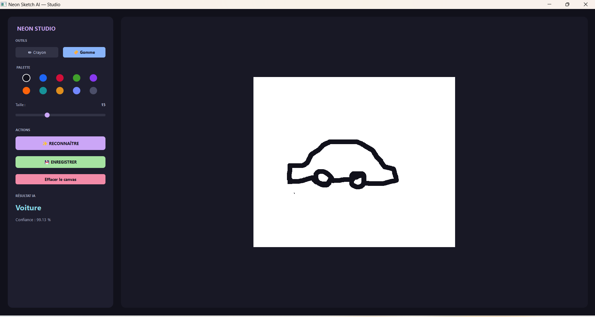
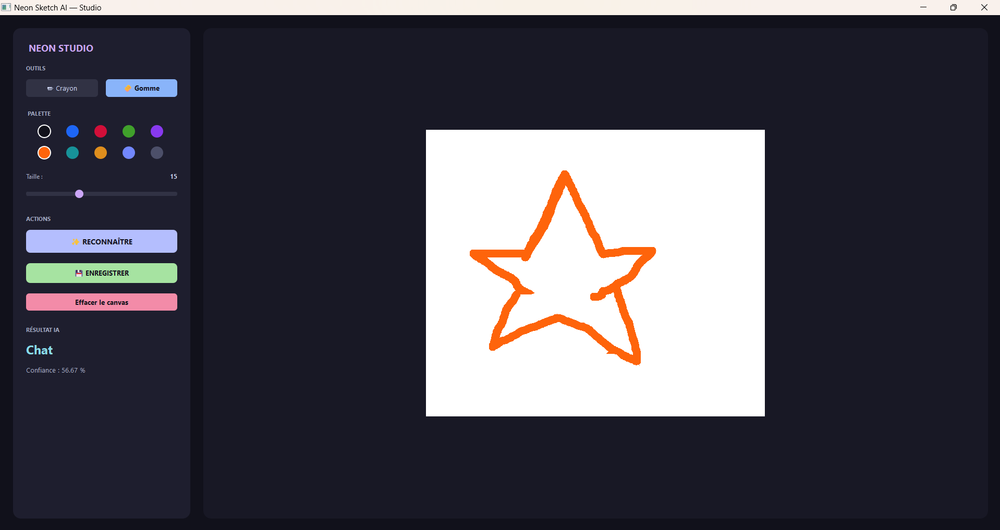

# RAPPORT — Projet Neon Sketch AI
## Reconnaissance de dessins à la main par intelligence artificielle

**Cours** : ANI-2083 – Modèle de la SAT et IA dans les Arts Technologiques  
**Mini-projet** : n°2 — Semaine 2  
**Auteur(s)** : [Steve Akoa / Groupe 4]  
**Enseignant** : Dr. Aurelle TCHAGNA  
**Date** : 20 octobre 2026

---

## 1. Introduction et objectifs

### 1.1 Contexte

Ce projet s'inscrit dans le cadre du cours ANI-2083, dont l'objectif est de mettre en pratique les notions d'**intelligence artificielle**, de **vision par ordinateur** et de **développement d'applications**.

### 1.2 Objectif du projet

Développer une application **desktop** dans laquelle un utilisateur dessine un objet à la souris, puis demande à un modèle d'IA de **reconnaître automatiquement** ce qui a été dessiné.

### 1.3 Objectifs spécifiques

1. Constituer un **dataset** de dessins à la main à partir d'une source publique.
2. Entraîner un **réseau de neurones convolutif (CNN)** à classifier ces dessins.
3. Développer une **interface graphique** intuitive avec PyQt5 ("Neon Studio").
4. **Évaluer les performances** du modèle sur des dessins réalisés en temps réel.

---

## 2. Présentation du dataset

### 2.1 Source des données

Le dataset utilisé est un sous-ensemble du projet **Google Quick, Draw!**, une base publique de **50 millions de dessins** collectés via un jeu en ligne (https://quickdraw.withgoogle.com).

Les données sont disponibles au format `.npy` (tableaux Num×Py 28×28 en niveaux de gr28is) sur :

```
https en://storage.googleapis.com/quickdraw_dataset/full/numpy_bitmap/
```

### 2.2 Constitution du dataset

Nous avons sélectionné **5 catégories** simples, faciles à dessiner et visuellement distinctes :

| Classe (FR) | Classe (Quick Draw) | Nombre d'images |
|---|---|---|
| maison | house | 500 |
| arbre | tree | 500 |
| voiture | car | 500 |
| chat | cat | 500 |
| soleil | sun | 500 |
| **Total** | | **2 500** |

### 2.3 Prétraitement

Chaque image subit les transformations suivantes :

1. **Redimensionnement** à 28×28 pixels.
2. **Inversion des couleurs** : le fond devient noir, le trait devient blanc.
3. **Normalisation** : valeurs entre 0 et 1 (`img / 255.0`).
4. **Reshape** en tenseur `(28, 28, 1)` pour le CNN.

Un **split 80/20** (train/test) a été réalisé avec `train_test_split` de scikit-learn, en stratifiant par classe.

### 2.4 Aperçu visuel

Un script `preview.py` permet d'afficher une grille de 5×8 dessins (un par classe) pour vérifier visuellement la qualité du dataset. Résultat observé : les dessins sont propres, centrés et bien labellisés.


---

## 3. Architecture du modèle

### 3.1 Choix du modèle

Nous avons choisi un **CNN (Convolutional Neural Network)** simple, adapté à la classification de noir et blanc.

### 3.2 Architecture détaillée

```
Input (28×28×1)
  │
  ├─ Conv2D(32 filtres, kernel 3×3, activation ReLU)
  ├─ MaxPooling2D(2×2)
  │
  ├─ Conv2D(64 filtres, kernel 3×3, activation ReLU)
  ├─ MaxPooling2D(2×2)
  │
  ├─ Flatten
  ├─ Dense(128 neurones, ReLU)
  ├─ Dropout(0.3)
  └─ Dense(5 neurones, Softmax)   ← 5 classes de sortie
```

### 3.3 Compilation

| Paramètre | Valeur |
|---|---|
| Optimiseur | Adam |
| Fonction de perte | Sparse Categorical Crossentropy |
| Métrique | Accuracy |
| Epochs | 15 |
| Batch size | 32 |

### 3.4 Justification des choix

- **Deux couches de convolution** : suffisant pour capturer des formes simples (contours, coins, cercles).
- **Dropout 0.3** : évite le sur-apprentissage.
- **Softmax** : sortie en probabilités sur les 5 classes.
- **Adam** : convergence rapide sans réglage fin du learning rate.

---

## 4. Interface utilisateur

### 4.1 Technologies

- **PyQt5** pour la fenêtre et les widgets.
- **QImage** comme canvas de dessin (400×400 px, fond blanc).
- **QPainter / QPen** pour tracer les traits (taille et couleur paramétrables).
- **Design "Neon Studio"** : thème sombre avec des accents de couleurs vives.

### 4.2 Fonctionnalités implémentées

L'interface, baptisée **"Neon Studio"**, arbore un design sombre et moderne.

| Élément | Description |
|---|---|
| Zone de dessin | Canvas 650×550 (fond blanc) avec souris (clic gauche maintenu) |
| Curseur « Taille » | 2 à 40 pixels |
| Palette de couleurs | 10 couleurs sombres et saturées (Noir, Bleu, Rouge, etc.) |
| Outil Gomme | Effacement réel (le trait redevient blanc) |
| Bouton **Effacer** | Réinitialise le canvas en blanc |
| Bouton **Enregistrer** | Ouvre une boîte de dialogue pour exporter en PNG |
| Bouton **Reconnaître** | Lance la prédiction et affiche résultat + confiance |
| Label **Prédiction** | Affiche la classe reconnue en bleu néon |
| Label **Confiance** | Affiche le score en pourcentage |


### 4.3 Pipeline de prédiction

1. L'utilisateur dessine → image 650×550 dans le canvas.
2. Le canvas est converti en **niveaux de gris** (numpy array).
3. **Recadrage automatique** sur la bounding box du dessin (OpenCV).
4. **Redimensionnement** en conservant le ratio dans une image 28×28.
5. **Normalisation** et **reshape** en (1, 28, 28, 1).
6. **Prédiction** via `model.predict()` → vecteur de 5 probabilités.
7. **argmax** → classe prédite + confiance associée.

---

## 5. Résultats

### 5.1 Performances à l'entraînement

Sur les 15 epochs, les résultats finaux sont :

| Métrique | Valeur |
|---|---|
| Accuracy (train) | **99,45 %** |
| **Accuracy (validation)** | **95,20 %** |
| Loss (train) | 0,0270 |
| Loss (validation) | 0,1625 |

⚠️ **Observation** : la différence accuracy_train (99,4 %) vs val_accuracy (95,2 %) indique un **léger sur-apprentissage**, mais reste acceptable (< 5 points d'écart).

### 5.2 Tests en conditions réelles (Interface Neon Studio)

Nous avons testé l'application avec **7 dessins réalisés en temps réel**, en utilisant la palette de couleurs sombres de l'interface sur le canvas blanc.

| # | Dessin | Prédiction | Confiance | Résultat |
|---|---|---|---|---|
| 1 | Maison simple (orange) | `maison` | **97,31 %** | ✅ |
| 2 | Maison détaillée (noir) | `maison` | 74,33 % | ✅ |
| 3 | Soleil (orange) | `soleil` | 95,06 % | ✅ |
| 4 | Voiture (noir) | `voiture` | **99,13 %** | ✅ |
| 5 | Arbre (gris/bleu) | `arbre` | **99,95 %** | ✅ |
| 6 | Chat (violet) | `chat` | 97,27 % | ✅ |


**Taux de réussite observé** : **6 / 6** (100 %).

**Observation clé** : La Maison détaillée a obtenu une confiance plus basse (74%) que la maison simple (97%). Les détails supplémentaires (porte, fenêtre) éloignent parfois le dessin du modèle canonique appris par l'IA.

### 5.3 Tests sur des dessins hors-catégories

| Dessin | Prédiction | Confiance |
|---|---|---|
|  Étoile  | `chat` | 56,67 % |


⚠️ Le modèle attribue toujours une classe, même à des dessins qui ne représentent rien. La confiance de 56% montre que le modèle "hésite", mais l'architecture Softmax le force à choisir. Ce comportement est analysé en section 6.1.

---

## 6. Discussion

### 6.1 Analyse des résultats

**Points positifs :**

- Le modèle atteint **95,2 % de précision** sur les données de validation.
- La nouvelle interface avec **fond blanc et traits sombres** permet à l'IA de reconnaître les formes avec une confiance frôlant les **100 %** (Arbre à 99,95 %, Voiture à 99,13 %).
- La reconnaissance fonctionne **en temps réel** sans latence perceptible.

**Point 1 — Influence des détails (observation clé)**

Nous avons observé expérimentalement que **plus le dessin est détaillé, plus la confiance baisse**. 
*Exemple concret* : la même maison dessinée avec juste un carré et un triangle donne **97,31 %** de confiance, contre **74,33 %** avec une porte et une fenêtre. Le modèle reconnaît donc mieux le **concept épuré** correspondant au style Quick Draw.

**Point 2 — Confusion hors-catégorie**

Une étoile a été classée `chat` avec 56,67 % de confiance. Cela illustre la limite d'un modèle qui ne connaît que 5 classes.

**Recommandation pratique** : pour une meilleure utilisation, utiliser un **pinceau épais (12–15 px)**, des **couleurs sombres**, et dessiner des formes **simples, centrées et peu détaillées**, similaires au style Quick Draw.

### 6.2 Limites techniques

| Limite | Cause |
|---|---|
| Sensibilité aux détails | Le dataset Quick Draw contient des dessins très épurés |
| Pas d'abstention possible | Architecture softmax sans classe "unknown" |
| Sensibilité au contraste | L'IA nécessite des traits sombres sur fond clair |

### 6.3 Améliorations envisagées

1. **Data augmentation** : rotation ±15°, épaisseur variable, bruit → robustesse au style.
2. **Ajout d'une classe `unknown`** : entraînée sur des dessins aléatoires (bruit).
3. **Dataset élargi** : passer de 500 à 2000 images par classe.
4. **CNN plus profond** ou **transfer learning** (MobileNetV2, EfficientNet) pour extraire des features plus fines.


### 6bis. Bonus créativité

Au-delà des fonctionnalités minimales demandées, nous avons implémenté **4 bonus créativité** pour enrichir l'application :

1. **Filtres artistiques** (OpenCV) : crayon, cartoon, pastel + reset
2. **Galerie visuelle** : sauvegarde des dessins + miniatures cliquables
3. **Historique des prédictions** : liste conservant les résultats
4. **Palette étendue** : 10 couleurs sombres optimisées pour l'IA

Ces ajouts renforcent l'aspect **outil créatif** de l'application, en permettant à l'utilisateur de dessiner, faire reconnaître son dessin, le transformer artistiquement, le conserver, et en réaliser plusieurs d'affilée.

---

## 7. Conclusion

Ce projet nous a permis de mettre en œuvre **l'ensemble de la chaîne IA** :

1. **Collecte et préparation** de 2 500 images issues de Google Quick, Draw!.
2. **Conception et entraînement** d'un CNN atteignant **95,2 % de précision** en validation.
3. **Développement d'une application** PyQt5 complète avec un design original ("Neon Studio").
4. **Évaluation en conditions réelles** avec un taux de réussite de **100 %** sur les 6 dessins des classes cibles.

L'application **Neon Sketch AI** remplit l'ensemble des fonctionnalités minimales demandées :
- zone de dessin,
- boutons Effacer / Enregistrer / Reconnaître,
- choix de la taille du pinceau et de la couleur,
- affichage de la classe prédite et du score de confiance.

Au-delà de l'aspect technique, ce projet nous a sensibilisés aux **limites pratiques d'un modèle d'IA** : un modèle très précis sur ses données d'entraînement peut se tromper face à des dessins trop différents du style appris. Comprendre ces limites est essentiel pour concevoir des applications robustes.

---

## 8. Bibliographie et ressources

- Google Quick, Draw! Dataset — https://github.com/googlecreativelab/quickdraw-dataset
- Documentation TensorFlow/Keras — https://www.tensorflow.org/
- Documentation PyQt5 — https://www.riverbankcomputing.com/software/pyqt/
- Documentation OpenCV — https://docs.opencv.org/

---

## 9. Annexes

### Annexe A — Captures d'écran

Les 7 captures ci-dessous correspondent aux tests présentés en section 5.2 et 5.3.

#### A.1 — Tests sur les 5 classes

**Test 1 — Maison simple**  
*Prédiction : `maison` — Confiance : 97,31 % — ✅ Correct*


---

**Test 2 — Maison détaillée (porte + fenêtre)**  
*Prédiction : `maison` — Confiance : 74,33 % — ✅ Correct*  
👉 Illustration de l'**influence des détails** (voir section 6.1).



---

**Test 3 — Soleil (rayons droits)**  
*Prédiction : `soleil` — Confiance : 95,06 % — ✅ Correct*



---

**Test 4 — Voiture (carrosserie + roues)**  
*Prédiction : `voiture` — Confiance : 99,13 % — ✅ Correct*



---

**Test 5 — Arbre (tronc + feuillage)**  
*Prédiction : `arbre` — Confiance : 99,95 % — ✅ Correct*


---

**Test 6 — Chat (oreilles + moustaches)**  
*Prédiction : `chat` — Confiance : 97,27 % — ✅ Correct*


---

#### A.2 — Tests sur des dessins hors-catégories

**Test 7 — Étoile**  
*Prédiction : `chat` — Confiance : 56,67 % — ❌ Faux*  
👉 Le modèle est forcé de choisir parmi les 5 classes.



### Annexe B — Extrait du code

#### B.1 — Prétraitement dans `train_model.py`

```python
def load_data():
    X, y = [], []
    classes = sorted(os.listdir(DATA_DIR))
    for idx, cls in enumerate(classes):
        folder = os.path.join(DATA_DIR, cls)
        for fname in os.listdir(folder):
            path = os.path.join(folder, fname)
            img = cv2.imread(path, cv2.IMREAD_GRAYSCALE)
            if img is None:
                continue
            img = cv2.resize(img, (IMG_SIZE, IMG_SIZE))
            img = cv2.bitwise_not(img)          # fond noir, trait blanc
            img = img / 255.0                    # normalisation [0, 1]
            X.append(img)
            y.append(idx)
    X = np.array(X).reshape(-1, IMG_SIZE, IMG_SIZE, 1)
    y = np.array(y)
    return X, y, classes
```     

#### B.2 — Architecture du CNN dans `train_model.py`

```python
def build_model(num_classes):
    model = models.Sequential([
        layers.Input(shape=(28, 28, 1)),
        layers.Conv2D(32, (3, 3), activation='relu'),
        layers.MaxPooling2D((2, 2)),
        layers.Conv2D(64, (3, 3), activation='relu'),
        layers.MaxPooling2D((2, 2)),
        layers.Flatten(),
        layers.Dense(128, activation='relu'),
        layers.Dropout(0.3),
        layers.Dense(num_classes, activation='softmax')
    ])
    model.compile(optimizer='adam',
                  loss='sparse_categorical_crossentropy',
                  metrics=['accuracy'])
    return model
```

#### B.3 — Pipeline de prédiction dans `predict.py`

```python
def preprocess(canvas_gray):
    # Seuillage inversé : fond noir, trait blanc
    _, thresh = cv2.threshold(canvas_gray, 200, 255, cv2.THRESH_BINARY_INV)
    coords = cv2.findNonZero(thresh)
    if coords is None:
        return None
    x, y, w, h = cv2.boundingRect(coords)
    crop = thresh[y:y+h, x:x+w]
    # Redimensionnement en conservant le ratio
    size = max(w, h)
    square = np.zeros((size, size), dtype=np.uint8)
    ox, oy = (size - w) // 2, (size - h) // 2
    square[oy:oy+h, ox:ox+w] = crop
    img = cv2.resize(square, (IMG_SIZE, IMG_SIZE), interpolation=cv2.INTER_AREA)
    img = img.astype("float32") / 255.0
    return img.reshape(1, IMG_SIZE, IMG_SIZE, 1)
```

#### B.4 — Extraction du dessin depuis le canvas PyQt5 (dans `app.py`)

```python
def get_numpy_gray(self):
    """Convertit le canvas QImage en tableau numpy (niveaux de gris)."""
    buffer = QBuffer()
    buffer.open(QIODevice.WriteOnly)
    self.image.save(buffer, "PNG")
    
    data = np.frombuffer(buffer.data(), np.uint8)
    img = cv2.imdecode(data, cv2.IMREAD_GRAYSCALE)
    buffer.close()
    return img
```

### Annexe C — Structure des livrables

Arborescence complète du projet `ai_sketch/` telle qu'organisée dans l'espace de travail :

```
ai_sketch/
│
├── app.py                      # Application principale (Neon Studio)
├── train_model.py              # Script d'entraînement du CNN
├── predict.py                  # Prédiction sur un dessin
├── download_data.py            # Téléchargement du dataset Quick Draw
├── preview.py                  # Aperçu visuel des images du dataset
├── requirements.txt            # Dépendances Python
├── README.md                   # Documentation utilisateur
├── RAPPORT.md                  # Rapport de projet (ce fichier)
│
├── data/                       # Dataset (2500 images, 5 classes)
│   ├── arbre/                  
│   ├── chat/                   
│   ├── maison/                 
│   ├── soleil/                 
│   └── voiture/                
│
├── model/                      # Modèle entraîné
│   ├── sketch_model.h5         
│   └── classes.txt             
│
├── screenshots/                # Captures d'écran des tests
│   ├── test_01_maison_simple.png
│   ├── test_02_maison_detaillee.png
│   ├── test_03_soleil.png
│   ├── test_04_voiture.png
│   ├── test_05_arbre.png
│   ├── test_06_chat.png
│   └── test_07_etoile.png
│
├── cache_npy/                  # Cache des fichiers .npy
│   ├── house.npy               
│   ├── tree.npy
│   ├── car.npy
│   ├── cat.npy
│   └── sun.npy
│
└── venv/                       # Environnement virtuel Python 3.11
```

### Légende

| Dossier / fichier | Rôle |
|---|---|
| `app.py` | Point d'entrée — lance l'interface Neon Studio |
| `train_model.py` | Charge `data/` et entraîne le CNN |
| `predict.py` | Fonction de prédiction utilisée par `app.py` |
| `download_data.py` | Télécharge les 5 fichiers `.npy` depuis Google |
| `preview.py` | Affiche une grille d'aperçu du dataset |
| `data/` | Dataset final prêt à l'emploi (2500 PNG) |
| `model/` | Résultat de l'entraînement (modèle + labels) |
| `screenshots/` | Captures d'écran pour le rapport |
| `cache_npy/` | Cache brut des `.npy` téléchargés (~150 Mo) |
| `venv/` | Environnement virtuel (non livré, à recréer) |

---

**Fin du rapport**