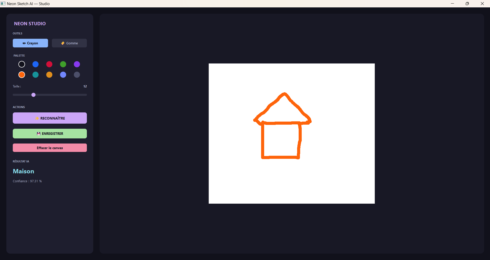
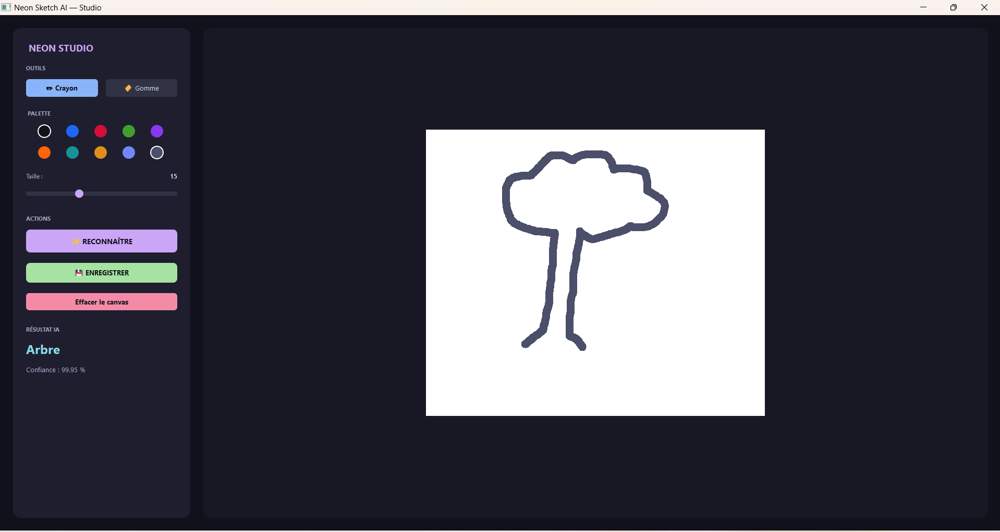
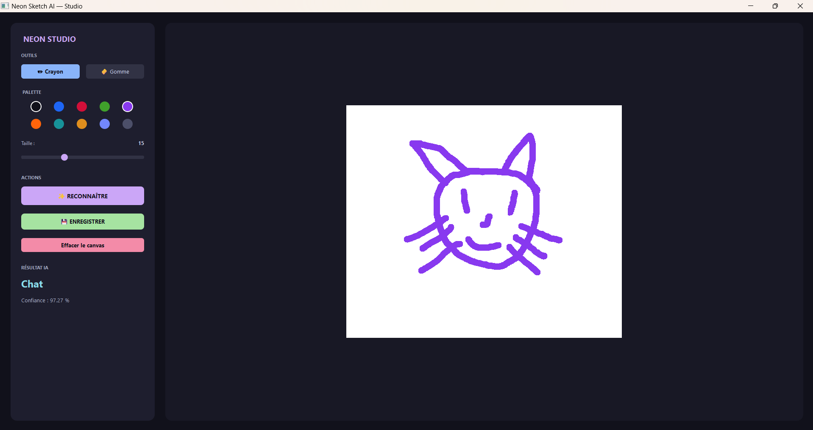

# Neon Sketch AI — Reconnaissance de dessins à la main

Projet du cours **ANI-2083 – Modèle de la SAT et IA dans les Arts Technologiques**
(Mini-projet 2 — Semaine 2)

**Auteur** : [Steve Akoa / Groupe 4]
**Date** : 20 octobre 2026
**Enseignant** : Dr. Aurelle TCHAGNA

---

## 1. Description

**Neon Sketch AI** est une application desktop moderne qui permet à l'utilisateur de **dessiner un objet à la souris** sur un canvas, puis de demander à un modèle d'intelligence artificielle de **reconnaître automatiquement** ce qui a été dessiné.

L'application arbore un design unique baptisé **"Neon Studio"** : un thème sombre (Dark Mode) élégant couplé à un canvas de dessin blanc pour un contraste optimal, et une palette de couleurs sombres spécialement sélectionnées pour optimiser la détection par l'IA.

Le modèle est un **réseau de neurones convolutif (CNN)** entraîné sur un sous-ensemble du dataset **Google Quick, Draw!**.


### Catégories reconnues

L'application distingue **5 classes** :

- 🏠 `maison`
- 🌳 `arbre`
- 🚗 `voiture`
- 🐱 `chat`
- ☀️ `soleil`

---

## 2. Démonstration

<p align="center">
  
</p>

**Exemple** : L'interface "Neon Studio" avec un dessin de maison simple correctement identifié avec **97,31 %** de confiance.

D'autres exemples sont disponibles dans le dossier `screenshots/` :
- `test_03_soleil.png` — soleil reconnu (95,06 %)
- `test_04_voiture.png` — voiture reconnue (99,13 %)
- `test_05_arbre.png` — arbre reconnu (99,95 %)
- `test_06_chat.png` — chat reconnu (97,27 %)
- `test_07_etoile.png` — cas de confusion (étoile classée `chat`)

<table>
  <tr>
    <td></td>
    <td></td>
    <td></td>
  </tr>
  <tr>
    <td align="center">Maison (97,31 %)</td>
    <td align="center">Arbre (99,95 %)</td>
    <td align="center">Chat (97,27 %)</td>
  </tr>
</table>


---

## 3. Structure du projet

```
ai_sketch/
│
├── app.py # Application principale (Neon Studio - PyQt5)
├── train_model.py # Script d'entraînement du CNN
├── predict.py # Prédiction sur un dessin
├── download_data.py # Téléchargement du dataset Quick Draw
├── preview.py # Aperçu visuel des images du dataset
├── requirements.txt # Dépendances Python
├── README.md # Ce fichier
├── RAPPORT.md # Rapport de projet
├── RAPPORT.pdf # Rapport (version PDF)
│
├── data/ # Dataset (2500 images, 5 classes)
│ ├── arbre/ # 500 images (.png)
│ ├── chat/ # 500 images (.png)
│ ├── maison/ # 500 images (.png)
│ ├── soleil/ # 500 images (.png)
│ └── voiture/ # 500 images (.png)
│
├── model/ # Modèle entraîné
│ ├── sketch_model.h5 # Réseau de neurones (format HDF5)
│ └── classes.txt # Liste des classes (ordre des labels)
│
├── screenshots/ # Captures d'écran des tests
│ ├── test_01_maison_simple.png
│ ├── test_02_maison_detaillee.png
│ ├── test_03_soleil.png
│ ├── test_04_voiture.png
│ ├── test_05_arbre.png
│ ├── test_06_chat.png
│ └── test_07_etoile.png
│
├── cache_npy/ # Cache des fichiers .npy téléchargés
│ ├── house.npy
│ ├── tree.npy
│ ├── car.npy
│ ├── cat.npy
│ └── sun.npy
│
└── venv/ # Environnement virtuel Python 3.11
```

### Légende

| Dossier / fichier | Rôle |
|---|---|
| `app.py` | Point d'entrée — lance l'interface "Neon Studio" |
| `train_model.py` | Charge `data/` et entraîne le CNN |
| `predict.py` | Fonction de prédiction utilisée par `app.py` |
| `download_data.py` | Télécharge les 5 fichiers `.npy` depuis Google |
| `preview.py` | Affiche une grille d'aperçu du dataset |
| `data/` | Dataset final prêt à l'emploi (2500 PNG) |
| `model/` | Résultat de l'entraînement (modèle + labels) |
| `screenshots/` | Captures d'écran pour le rapport |
| `cache_npy/` | Cache brut des `.npy` téléchargés (~150 Mo) |
| `venv/` | Environnement virtuel (non livré, à recréer avec `py -3.11 -m venv venv`) |


---

## 4. Installation

### Prérequis

- **Python 3.11** (obligatoire — TensorFlow 2.15 ne supporte pas Python 3.13)
- Windows 10/11, Linux ou macOS
- Environ 500 Mo d'espace disque

### Étapes

**1. Télécharger et installer Python 3.11**

Lien officiel : https://www.python.org/ftp/python/3.11.7/python-3.11.7-amd64.exe

⚠️ **Cocher impérativement** « Add python.exe to PATH » pendant l'installation.

**2. Créer un environnement virtuel**

```bash
cd C:\ai_sketch
py -3.11 -m venv venv
venv\Scripts\activate     # Windows
# ou
source venv/bin/activate   # Linux/Mac
```

**3. Installer les dépendances**

```bash
pip install --upgrade pip
pip install -r requirements.txt
```

**4. (Important — si la connexion est instable)**

Pour télécharger TensorFlow manuellement :

- Aller sur https://pypi.org/project/tensorflow-intel/2.15.0/#files
- Chercher `tensorflow_intel-2.15.0-cp311-cp311-win_amd64.whl` (~287 Mo)
- Installer localement :

```bash
pip install "chemin/vers/tensorflow_intel-2.15.0-cp311-cp311-win_amd64.whl"
```

---

## 5. Utilisation

### Étape 1 — Télécharger le dataset (facultatif si `data/` est déjà rempli)

```bash
python download_data.py
```

Télécharge 500 images par classe depuis Google Quick, Draw! dans `data/`.

### Étape 2 — Entraîner le modèle

```bash
python train_model.py
```

Durée : **3 à 10 minutes sur CPU**. À la fin, le modèle est enregistré dans `model/sketch_model.h5`.

Résultat attendu :

```
Epoch 15/15
loss: 0.0270 - accuracy: 0.9945 - val_loss: 0.1625 - val_accuracy: 0.9520
Modèle enregistré : model/sketch_model.h5
```

### Étape 3 — Lancer l'application

```bash
python app.py
```

La fenêtre **Neon Studio** s'ouvre. Dessinez dans la zone blanche, puis cliquez sur **Reconnaître**.

---

## 6. Fonctionnalités

| Fonctionnalité | Statut |
|---|---|
|Interface moderne "Dark Mode" (Neon Studio) | ✅ |
| Zone de dessin à la souris(fond blanc) | ✅ |
| Choix de la taille du pinceau (2 à 40) | ✅ |
| Palette de 10 couleurs sombres optimisées pour l'IA | ✅ |
|Outil Gomme (effacement réel) | ✅ |
| Bouton **Effacer** | ✅ |
| Bouton **Enregistrer** (export PNG) | ✅ |
| Bouton **Reconnaître** (prédiction) | ✅ |
| Affichage de la classe prédite en bleu néon | ✅ |
| Affichage du score de confiance | ✅ |
| Gestion du cas « modèle manquant » | ✅ |

---

## 7. Résultats des tests

### 7.1 Protocole

Nous avons testé l'application avec 7 dessins réalisés en temps réel, en utilisant la palette de couleurs sombres de l'interface "Neon Studio" sur le canvas blanc.

### 7.2 Tests sur les 5 classes

| # | Dessin | Prédiction | Confiance | Verdict |
|---|---|---|---|---|
| 1 | Maison simple (orange) | `maison` | **97,31 %** | ✅ |
| 2 | Maison  détaillée  (noir) | `maison` | 74,33 % | ✅ |
| 3 | Soleil (orange) | `soleil` | **95,06 %** | ✅ |
| 4 | Voiture (noir) | `voiture` | 99,13 % | ✅ |
| 5 | Arbre (gris/bleu) | `arbre` | 99,95 % | ✅ |
| 6 | Chat (violet) | `chat` | 97,27 % | ✅ |

**Taux de réussite** : **6 / 6** (100 %).

### 7.3 Tests sur des dessins hors-catégories

| # | Dessin | Prédiction | Confiance |
|---|---|---|---|
| 7 | Étoile (orange) | `chat` | 56,67 % |

👉 Le modèle **force** toujours une réponse parmi les 5 classes, même pour des dessins hors-catégories.

### 7.4 Observation importante : l'impact du fond blanc et du contraste

L'utilisation d'un fond blanc couplé à des couleurs sombres dans l'interface "Neon Studio" a considérablement amélioré la précision.
Les traits sont parfaitement détectés par l'IA, ce qui élimine les erreurs "Vide" observées dans les versions précédentes avec des couleurs pastel sur fond sombre. De plus, nous avons remarqué qu'un dessin trop détaillé (ex: maison avec porte et fenêtre à 74%) fait baisser la confiance par rapport à un dessin épuré (maison simple à 97%).


---

## 8. Limites et améliorations possibles

### Limites observées

- **Sensibilité au détails** :  ajouter trop de détails (porte, fenêtre) fait chuter la confiance car le modèle préfère les formes simples (style Quick Draw).
- **Pas de classe « inconnu »** : un dessin hors-catégorie (étoile) est toujours classé dans une des 5 classes avec une confiance plus ou moins élevée (56%).
- **Contraste des couleurs** : l'IA nécessite un fort contraste. L'interface finale restreint la palette à des couleurs sombres pour pallier cela.

### Améliorations envisagées

- **Data augmentation** (rotation, épaisseur, bruit) pour rendre le modèle robuste au style.
- **Ajout d'une classe `unknown`** entraînée sur des dessins aléatoires.
- **Plus d'images par classe** (au lieu de 500, passer à 2000).
- **CNN plus profond** ou transfer learning avec MobileNet.

---

## 9. Technologies utilisées

| Bibliothèque | Version | Rôle |
|---|---|---|
| Python | 3.11.7 | Langage principal |
| PyQt5 | 5.15.10 | Interface graphique |
| TensorFlow | 2.15.0 | Réseau de neurones |
| Keras | 2.15.0 | API haut niveau |
| OpenCV | 4.9.0.80 | Traitement d'images |
| NumPy | 1.26.4 | Calcul numérique |
| Pillow | 10.2.0 | Manipulation d'images |
| Matplotlib | 3.8.3 | Aperçu du dataset |
| scikit-learn | 1.4.2 | Split train/test |

---

## 10. Licence et données

- **Code** : usage strictement pédagogique.
'- **Datasetimages** : Google Quick, Draw! (licence CC BY 4.0).
  Source : https://github.com/googlecreativ elab/quickdraw-dataset

28---

## 11. Auteur

**Nom** : [Steve Akoa / Groupe 4]
**Cours** : ANI-2083 – Modèle de la SAT et IA dans les Arts Technologiques
**Date de remise** : Mardi 27 octobre 2026.